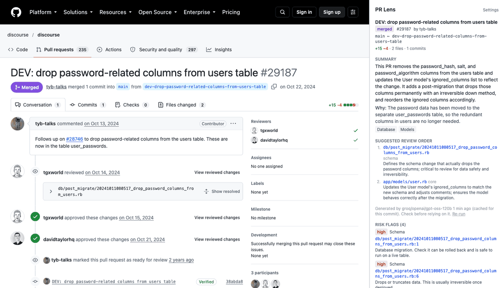
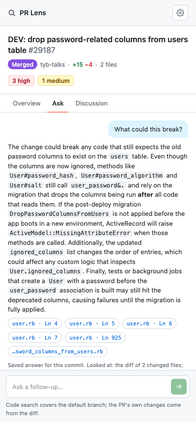
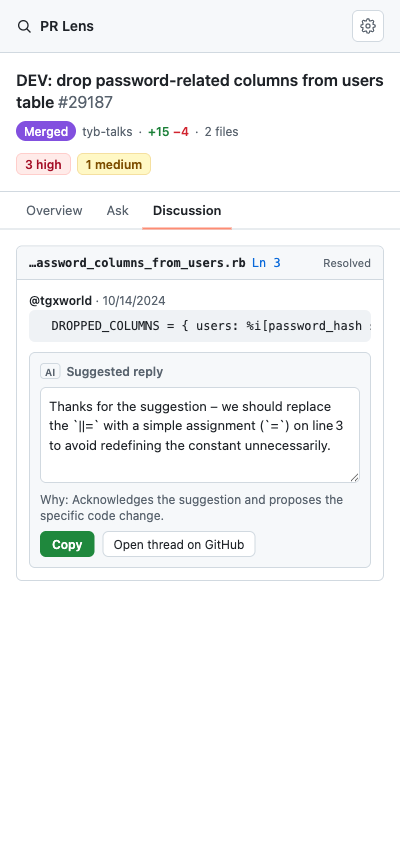
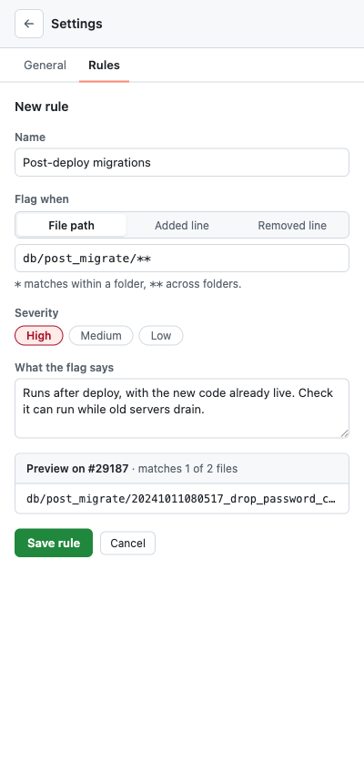
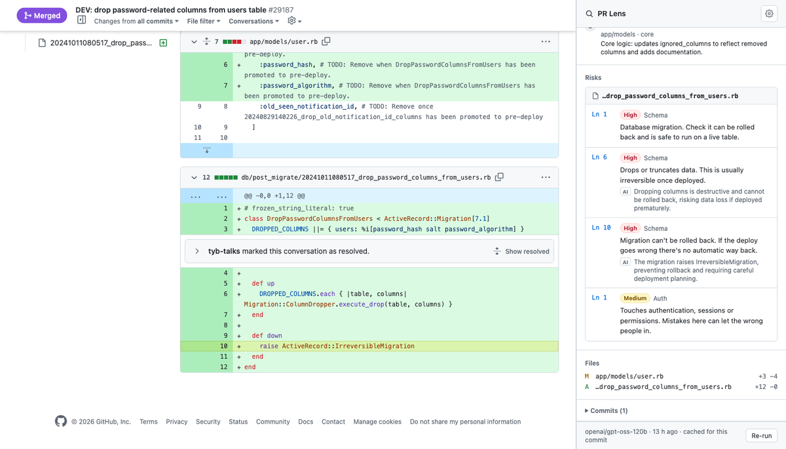

# PR Lens

A Chrome extension that helps you review a GitHub pull request. Open a PR, open the side panel, and you get:

- **A plain-English summary**: what the PR changes and the likely reason, from its description, commits and linked issues.
- **A suggested review order**: migrations and schema first, then core logic, then API and UI, then tests.
- **Risk flags** that link to the exact line: migrations, destructive drops, migrations with no rollback, auth and payment code, CI config, new dependencies, possible secrets, deleted or skipped tests.
- **Ask the PR**: questions like "does anything still read `password_hash`?", answered from the diff, files at the PR's commit and code search, with sources you can click.
- **Discussion**: the PR's review threads, with a suggested reply for any of them that you can edit and copy into GitHub.
- **Your own rules**: flag paths (`**/billing/**`) or added and removed lines (`TODO`, or a regular expression), with a live preview on the open PR. Built-in categories that are noise for you can be switched off.

Nothing is posted to GitHub. The panel is for the reviewer only, which is the main difference from tools that add bot comments to the PR for everyone.



*[discourse/discourse#29187](https://github.com/discourse/discourse/pull/29187), a migration that drops password columns from the users table and can't be rolled back: the PR Lens button, the summary and review order, a risk flag that jumps to the line, Ask, a suggested reply, and a custom rule with its live preview.*

| Ask the PR | Suggested reply | Your own rules |
|---|---|---|
|  |  |  |

## How it works

```
GitHub PR tab ── side panel (React) ──► backend (Hono on Cloudflare Workers)
      ▲               │                     ├─ GitHub API: PR, commits, files, linked issues
      │               │                     ├─ risk engine: rules over paths and diff lines
      └─ content script: scroll to line     ├─ LLM pipeline: map/reduce, free providers with fallback
                                            └─ KV cache, keyed by head commit
```

**Two requests, so the panel is useful right away.** `GET /api/prs/:owner/:repo/:number` returns the PR and rule-based flags in about a second. `.../analysis` runs the LLM, which can take a while on free tiers. The panel shows the first as soon as it arrives and fills in the second.

**Rules first, LLM second.** A rule engine tags every file by path (migrations, auth, payments, CI, dependencies) and every diff line by content (destructive SQL and ORM drops, `IrreversibleMigration`, key-like strings, skipped tests). It costs nothing, runs on every file, and its flags go into the LLM prompt.

**Large diffs.** Files are sent to the model in small chunks (map), with every diff line numbered (`R12` is line 12 of the new file, `L7` line 7 of the old one) so the model can cite lines. The per-file notes are combined into the summary and review order (reduce). Lockfiles, generated and vendored files are never sent. When a PR is over budget, flagged files go first, and the panel lists what wasn't read.

**The model's output is validated.** Every reply is parsed with Zod and retried once with the error if it doesn't fit. A line the model cites must exist in the diff it was shown, or the concern loses its line link: an invented line never becomes a link to the wrong place.

**Free LLM tiers, with fallback.** Groq (two models, each with its own quota), then Gemini, then OpenRouter. A short rate limit is waited out; a long one, a timeout or an outage sends the request to the next provider. The chain was tuned against measured free-tier behavior; see [docs/decisions.md](docs/decisions.md).

**Ask: plan, gather, answer.** A question takes two LLM calls. First the model picks up to three identifiers to search for and files to read. The backend gathers that context (the diff, excerpts of files at the PR's head commit, GitHub code search) within a size budget, and the model answers from it. As with flags, every source it cites must be in what it was shown. Repository text and comments go into the prompt marked as untrusted data, so instructions hidden in a PR can't steer it. Code search only covers the default branch; the PR's own changes come from the diff.

**Per-user limits.** Requests that actually run the AI count against the GitHub login behind the token (30 an hour, 100 a day by default). Cached results are free. It's a free-tier backend, so the point isn't cost but one person not using up everyone's quota.

**Cached by head commit.** Results are stored in Cloudflare KV per head SHA and pipeline version, so reopening a PR takes about half a second and uses no LLM quota. A new push gets a fresh analysis. Only public repos are cached.



## Try it

The backend is deployed on Cloudflare Workers, and a production build of the extension uses it by default.

```bash
npm install
npm run build -w extension
```

Then in Chrome: `chrome://extensions` → Developer mode → **Load unpacked** → `extension/dist`. Open any public PR and click the **PR Lens** button next to the PR's title (or press Alt+Shift+P). The panel asks for a [fine-grained GitHub token](https://github.com/settings/personal-access-tokens/new) with "Public repositories" access; it's stored only in your browser.

Requires Node 22.12+ (`.nvmrc` says 24).

## Run the backend locally

```bash
# LLM keys go in backend/.dev.vars (git-ignored). Without any, the panel still shows PR data and rule flags.
cp backend/.dev.vars.example backend/.dev.vars    # then add GROQ_API_KEY and/or GEMINI_API_KEY
npm run dev -w backend                            # http://localhost:8787
npm run dev -w extension                          # dev builds talk to localhost:8787
```

Or point a production build at it in the panel's Settings. Free keys: [Groq](https://console.groq.com/keys), [Google AI Studio](https://aistudio.google.com/apikey), [OpenRouter](https://openrouter.ai/settings/keys).

## Deploy

```bash
cd backend
npx wrangler login                                   # once
npm run deploy                                       # creates the KV namespace on first deploy
printf '%s' "$KEY" | npx wrangler secret put GROQ_API_KEY   # once per key
```

CORS only allows the extension IDs in `ALLOWED_EXTENSION_IDS` (`backend/wrangler.jsonc`). The ID is fixed by the public `key` in `extension/manifest.json`.

## Tests

```bash
npm test -w backend
```

88 Vitest tests cover the risk rules (including regression cases from real PRs the first rules missed), patch parsing, chunking, the provider fallback chain with fake providers (rate limits, outages, malformed JSON), the validation of model output, and caching.

## Project layout

```
extension/   Chrome extension (Manifest V3, React, Vite + CRXJS, Tailwind)
  src/background/   service worker: opens the panel from the toolbar icon or shortcut
  src/sidepanel/    the panel UI and settings
  src/content/      scrolls GitHub's Files tab to a flagged line
backend/     Hono on Cloudflare Workers
  src/github/       GitHub REST + GraphQL client
  src/risk/         rule engine
  src/llm/          chunking, prompts, providers, fallback chain, pipeline
  src/cache/        KV cache and keys
shared/      types used by both
docs/        decisions, demo PRs, images
```

## Design notes

Each tradeoff (backend choice, free providers, caching, why the content script exists) is written up in [docs/decisions.md](docs/decisions.md). Real PRs where PR Lens catches something are in [docs/demo-prs.md](docs/demo-prs.md).

## Roadmap

- GitHub OAuth, so private repos work without pasting a token
- Team rules from a file in the repo (`.github/pr-lens.yml`), shared by everyone reviewing it
- GitLab merge requests
